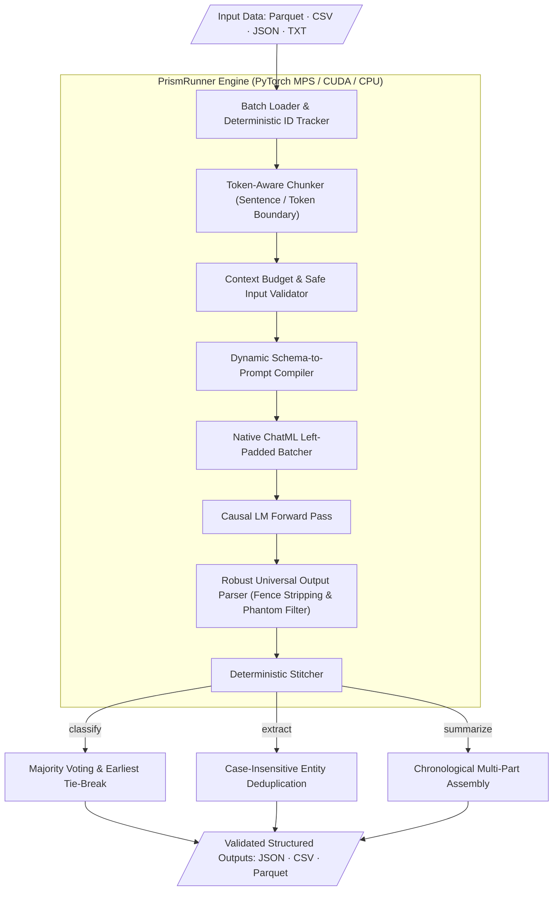

# PrismRunner

A high-throughput, local-first LLM inference engine and batch execution runtime designed to process structured datasets (Parquet, CSV, JSON) and raw text into strongly-typed Pydantic schemas. Built with PyTorch and Hugging Face `transformers` for zero-overhead, completely offline execution across Apple Silicon MPS, NVIDIA CUDA, and CPU.

---

## Architecture Overview



---

## 📚 User Documentation & Usage Guides

Comprehensive step-by-step guides, code recipes, and tutorials are available in the [**`docs/`**](file:///Users/david.lobue/Desktop/Agents/PrismRunner/docs/README.md) directory:

- [**01. Prompt Customization Guide**](file:///Users/david.lobue/Desktop/Agents/PrismRunner/docs/01_prompt_customization.md) — In-memory string/dict overrides, YAML templates, guidelines, and system prompts.
- [**02. Jupyter Notebook Guide**](file:///Users/david.lobue/Desktop/Agents/PrismRunner/docs/02_jupyter_notebooks.md) — Interactive workflows, in-cell Pydantic schemas, Pandas DataFrames, and dry-run previews.
- [**03. Python Package API Reference**](file:///Users/david.lobue/Desktop/Agents/PrismRunner/docs/03_python_package_usage.md) — Complete Python SDK reference for `PrismPipeline`, `SchemaMappingPipeline`, chunkers, and parsers.
- [**04. Standalone & CLI Reference**](file:///Users/david.lobue/Desktop/Agents/PrismRunner/docs/04_standalone_and_cli.md) — Standalone `python main.py` execution, CLI subcommands, flags, and shell recipes.
- [**05. Custom Schemas & Catalogs**](file:///Users/david.lobue/Desktop/Agents/PrismRunner/docs/05_custom_schemas_and_catalogs.md) — Writing Pydantic v2 schemas, dynamic string schemas, catalogs, and SQLite/wide-table exports.
- [**06. Configuration & Hardware Tuning**](file:///Users/david.lobue/Desktop/Agents/PrismRunner/docs/06_configuration_and_hardware.md) — Hardware acceleration (MPS, CUDA, CPU), VRAM batch sizing, and context budgeting.

---

## Key Core Innovations & Architectural Guarantees

### 1. Native ChatML Framing & Vectorized Batching
- **Generation Prompt Alignment**: All instruct models are executed via `tokenizer.apply_chat_template(messages, tokenize=False, add_generation_prompt=True)`. This completely prevents model prompt echoing and guarantees that generation starts in assistant mode.
- **Left-Padding Enforcement**: Batched generation strictly enforces `tokenizer.padding_side = "left"` with aligned attention masks.
- **Accelerator Support**: Automatic device mapping for Apple Silicon MPS (`torch.device("mps")`), NVIDIA CUDA (`torch.device("cuda")`), and CPU with memory cleanup (`torch.mps.empty_cache()` / `torch.cuda.empty_cache()` and `gc.collect()`).

### 2. Dynamic Schema-to-Prompt Compiler
- **No OpenAPI Leaks**: Never dumps raw JSON schemas, `$defs`, `$ref`, or nested `anyOf` blocks that confuse local LLMs.
- **Pydantic v2 Inspection**: Automatically parses Python `Enum` values, `Literal` definitions, field descriptions, and numeric bounds (`ge`, `le`, `gt`, `lt`).
- **Human-Readable Prompt Specs**: Generates bulleted constraints:
  ```text
  - "category": one of ['Technology', 'Business', 'Health'] - The primary domain.
  - "confidence": number (from 0.0 to 1.0) - Confidence metric.
  ```
- **Concrete Single-Item JSON Sample**: Automatically builds a valid sample JSON object directly in the prompt.

### 3. Robust Universal Output Parser
- **Resilient Decoding**: Strips markdown code fences (````json ... ````), extracts outer bracket boundaries (`[...]` and `{...}`), handles JSON Lines (JSONL), and repairs trailing commas.
- **Phantom Object Discarding**: Automatically detects and discards empty objects where all fields are `None`, preventing fallback bugs when schemas use optional fields with `default=None`.
- **Clean String Fallback**: When no schema is provided, cleanly returns stripped strings and bullet points.

### 4. Deterministic Stitcher
- **Classification**: Aggregates chunk-level labels via majority voting. In the event of an exact vote tie, deterministically selects the category from the earliest chronological chunk (`chunk_index` 0).
- **Extraction**: Merges entities across chunks, performing case-insensitive deduplication while preserving distinct metadata.
- **Summarization**: Chronologically orders chunks by `chunk_index`. Single-chunk records return clean text; multi-chunk records are formatted under distinct `--- [Part i/N] ---` section headers.

### 5. Token-Budgeted Context Chunker & Advisor
- **Sliding Window Chunking**: Token-aware chunker supporting sentence-boundary splitting (preserving semantic coherence) and strict token sliding windows with configurable overlap.
- **Context Budgeting**: Computes maximum safe input capacity:
  $$\text{Safe Input} = \text{Context Limit} - (\text{Max New Tokens} + \text{System Prompt} + \text{Template Tokens} + \text{Safety Buffer})$$
- **Model Inspector**: The `inspect-model` CLI command reports context limits, hardware utilization, and safe chunking recommendations.

---

## Installation

```bash
git clone https://github.com/childmindresearch/PrismRunner.git
cd PrismRunner
pip install -e .
```

---

## CLI Usage

### 1. Inspect Model Architecture & Context Budget
```bash
prismrunner inspect-model --model Qwen/Qwen2.5-3B-Instruct --device auto
```

### 2. Document Classification
Classify rows in a Parquet, CSV, or JSON dataset:
```bash
# Tabular batch classification
prismrunner classify \
  --input-path data/articles.parquet \
  --column text \
  --id-column article_id \
  --batch-size 8 \
  --output-path outputs/classified.json

# Direct text string classification
prismrunner classify \
  --input-text "NVIDIA announces new Blackwell Ultra GPUs with enhanced FP4 tensor cores." \
  --json
```

### 3. Entity & Item Extraction
```bash
# Extract entities with token-aware chunking for long documents
prismrunner extract \
  --input-path data/transcripts.csv \
  --column conversation \
  --chunk \
  --chunk-size 1024 \
  --chunk-overlap 64 \
  --batch-size 4 \
  --output-path outputs/extracted_entities.json
```

### 4. Multi-Chunk Document Summarization
```bash
prismrunner summarize \
  --input-path data/reports.json \
  --column content \
  --chunk \
  --chunk-size 1500 \
  --output-format csv \
  --output-path outputs/summaries.csv
```

### 5. Multi-Schema Extraction & Relational Mapping (SchemaMap Mode)
Extract across an entire catalog of Pydantic models with fast relevance triage, checkpoint resume, and relational aggregation into SQLite, normalized CSVs, and a 1-row-per-document wide table:
```bash
prismrunner map \
  --input-path data/clinical_notes.parquet \
  --schemas-dir schemas/clinical/ \
  --output-dir outputs/clinical_run/ \
  --export sqlite,csv,wide \
  --batch-size 8
```

### 6. Dry-Run Prompt Inspection
Verify prompt rendering, variable substitution, and schema injection without loading the model weights:
```bash
prismrunner classify \
  --input-text "Quantum computing breakthrough achieved at room temperature." \
  --var categories="Physics, Computing, Chemistry" \
  --dry-run
```

---

## Python API

```python
from pydantic import BaseModel, Field
from typing import Literal
from prismrunner import PrismPipeline

# Define any custom Pydantic schema
class TechAssessment(BaseModel):
    architecture: str = Field(description="Primary system architecture")
    maturity_level: Literal["experimental", "beta", "production"] = Field(description="Deployment maturity")
    score: float = Field(ge=0.0, le=10.0, description="Readiness score from 0 to 10")

# Initialize pipeline
pipeline = PrismPipeline()

# Run extraction into custom schema
results = pipeline.run(
    task="extract",
    input_data="Sample system report describing microservices transition...",
    schema_cls=TechAssessment,
    batch_size=4,
)

print(results)
```

---

## Configuration (`config/pipeline_config.yaml`)

```yaml
model:
  name: "Qwen/Qwen2.5-3B-Instruct"
  device: "auto"             # auto, mps, cuda, cpu
  torch_dtype: "auto"        # auto, float16, bfloat16, float32
  load_in_4bit: false
  load_in_8bit: false

inference:
  batch_size: 4
  max_new_tokens: 512
  temperature: 0.0
  system_prompt: "You are PrismRunner, an accurate local inference engine. Output structured JSON strictly adhering to schema."

chunking:
  enabled: false
  chunk_size: 1024
  chunk_overlap: 64
  strategy: "sentence"       # sentence or token
```

---

## License
MIT
