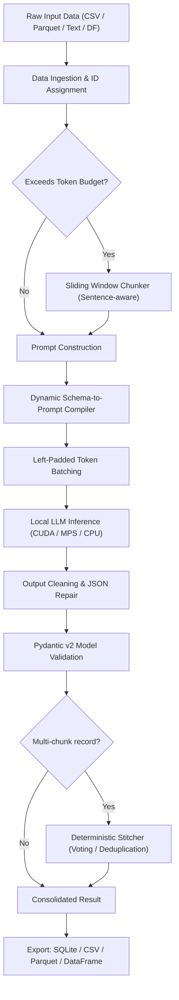

# PrismRunner Architecture & Internals

> Technical reference guide detailing PrismRunner's local-first batch execution engine, token management, schema compilation, and output parsing mechanics.

---

## 1. Design Philosophy

PrismRunner bridges the gap between raw data files and typed Python data structures. It transforms unstructured text and tabular datasets (**Parquet**, **CSV**, **JSON**, **JSONL**, **TXT**, or **Pandas DataFrames**) into strongly-typed **Pydantic v2 schemas** using local open-weight language models (e.g., Qwen, Llama, Mistral).

Instead of writing fragile custom glue code, prompt engineering hacks, and regex cleaners, PrismRunner provides a production-grade runtime that handles the entire execution lifecycle.

---

## 2. Core Subsystems

| Subsystem | What PrismRunner Does | Technical Implementation |
| :--- | :--- | :--- |
| **Data Ingestion** | Ingests Parquet, CSV, JSON, TXT, or Pandas DataFrames with automatic ID tracking. | Deterministic record ID preservation, column mapping, and streaming support for large tables. |
| **Context Chunking** | Sliding-window chunker respecting sentence boundaries and token budgets. | Tokenizer-aware segmentation that avoids mid-sentence splits while strictly staying within model context budgets. |
| **Schema Compiler** | Inspects Pydantic v2 classes to generate clean human-readable bullets and sample JSON. | Avoids leaking raw OpenAPI `$defs` or `$ref` blobs that confuse local open-weight models. Translates field types, defaults, and constraints into bulleted rules. |
| **Left-Padded Batching** | Left-pads tokens and aligns ChatML assistant generation prompts. | Formats tokens via HuggingFace `apply_chat_template` with left-padding (`padding_side="left"`), maximizing GPU/MPS batch throughput while eliminating prompt echoing. |
| **Robust Output Parser** | Strips markdown fences, fixes trailing commas, and filters phantom objects. | Multi-stage regex and AST JSON repair, validation against Pydantic models, and automatic purging of empty/hallucinated objects. |
| **Deterministic Stitcher** | Reassembles multi-chunk outputs into single consolidated results. | Aggregates across chunks using majority voting (classification), deduplication (entity extraction), or chronological section assembly (summarization). |
| **Multi-Schema Database Mapping** | Pre-screens chunks against entire catalogs using lightweight triage. | Fast relevance filtering to skip unnecessary model passes, outputting to SQLite (with foreign keys), relational CSVs, and 1-row-per-document wide tables. |

---

## 3. Execution Lifecycle

---

## 4. Hardware Optimization Details

* **Apple Silicon (MPS):** Leverages PyTorch Metal Performance Shaders with optimized memory allocation.
* **NVIDIA (CUDA):** Supports FP16, BF16, and optional 4-bit / 8-bit quantization via `bitsandbytes`.
* **CPU:** Automated fallback with multi-threaded inference for environments without dedicated accelerators.
