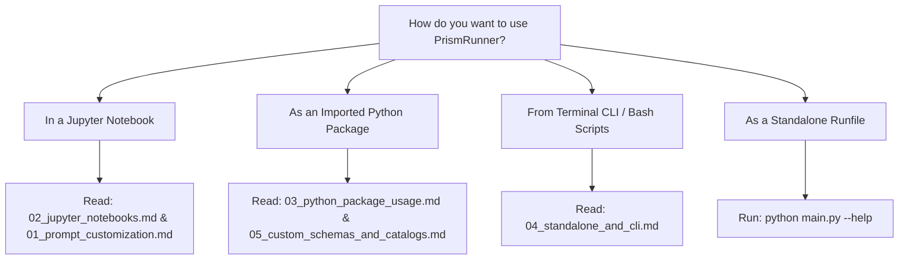

# PrismRunner Documentation & Usage Guides

Welcome to the comprehensive PrismRunner reference manuals. This directory provides step-by-step instructions, code recipes, and architectural deep-dives for using PrismRunner as an imported Python library, within Jupyter Notebooks, as a CLI tool, or as a standalone script.

---

## Guide Index

| Guide | Description | Target Audience |
| :--- | :--- | :--- |
| [**01. Prompt Customization**](file:///Users/david.lobue/Desktop/Agents/PrismRunner/docs/01_prompt_customization.md) | Complete guide to prompt slots, in-memory string/dict overrides, YAML templates, and system prompts. | Notebook users, Python developers |
| [**02. Jupyter Notebook Guide**](file:///Users/david.lobue/Desktop/Agents/PrismRunner/docs/02_jupyter_notebooks.md) | Interactive workflows: pandas integration, in-cell Pydantic schemas, and dry-run debugging. | Data scientists, researchers |
| [**03. Python Package API**](file:///Users/david.lobue/Desktop/Agents/PrismRunner/docs/03_python_package_usage.md) | Full Python SDK reference: `PrismPipeline`, `SchemaMappingPipeline`, chunkers, and parsers. | Software engineers, pipeline builders |
| [**04. Standalone & CLI Usage**](file:///Users/david.lobue/Desktop/Agents/PrismRunner/docs/04_standalone_and_cli.md) | CLI commands (`classify`, `extract`, `summarize`, `map`), arguments, and `main.py` execution. | Terminal users, automation scripts |
| [**05. Custom Schemas & Catalogs**](file:///Users/david.lobue/Desktop/Agents/PrismRunner/docs/05_custom_schemas_and_catalogs.md) | Defining Pydantic v2 models, multi-schema catalogs, triage filters, and SQLite/wide-table exports. | Domain modelers, data architects |
| [**06. Configuration & Hardware**](file:///Users/david.lobue/Desktop/Agents/PrismRunner/docs/06_configuration_and_hardware.md) | Tuning MPS, CUDA, CPU, context window budgeting, batch sizes, and `pipeline_config.yaml`. | DevOps, performance tuners |
| [**07. Architecture & Internals**](file:///Users/david.lobue/Desktop/Agents/PrismRunner/docs/07_architecture_and_internals.md) | Deep dive into batch execution runtime, token chunking, schema compiling, and parsing internals. | Core contributors, engineers |

---

## Quick Selection: How Do You Want to Use PrismRunner?

---

## Architecture at a Glance

PrismRunner operates on a zero-overhead, local-first execution model:
1. **Dynamic Schema-to-Prompt Compiler**: Inspects Pydantic models at runtime to produce human-readable specifications and concrete JSON format examples—never leaking raw JSON-schema `$defs` or `$ref` blobs.
2. **ChatML Framing**: Directly frames prompts through HuggingFace tokenizers with `add_generation_prompt=True` to prevent prompt echoing and guarantee assistant generation.
3. **Universal Output Parser**: Resiliently cleans markdown code fences, isolates JSON bracket bounds, filters out phantom objects (`None`-only hallucinations), and guarantees strict Pydantic model validation.
4. **Relational Aggregator & Triage**: Evaluates candidate schemas with fast pre-screening triage, skipping 80–90% of redundant inferences, and exports relational outputs into SQLite databases, normalized CSVs, and 1-row-per-document wide tables.
